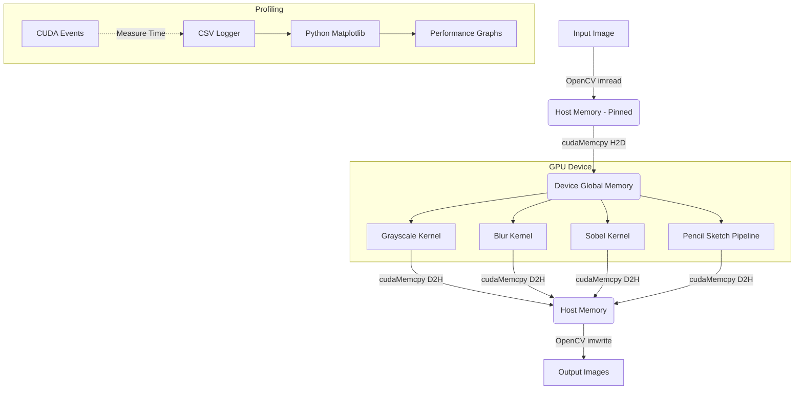
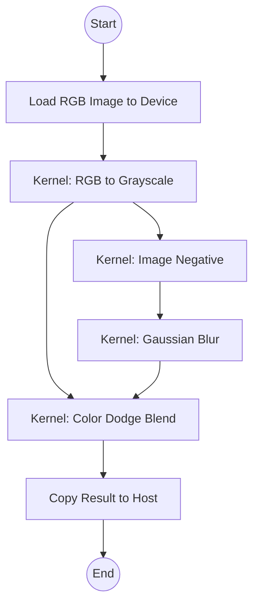

# Architecture and Flowcharts

## 1. High-Level Architecture

The system is split between the Host (CPU) and the Device (GPU). The Host manages file I/O, memory allocation, and orchestrates the kernel launches.

## 2. Pencil Sketch Pipeline Flowchart

The Pencil Sketch effect requires four distinct steps, chained together on the GPU.

## 3. Thread Mapping Strategy

For all 2D image processing kernels, we map the execution grid directly to the image coordinates.

*   `x = blockIdx.x * blockDim.x + threadIdx.x`
*   `y = blockIdx.y * blockDim.y + threadIdx.y`
*   Block Size: 16x16 threads
*   Grid Size: `Ceil(Width/16)` x `Ceil(Height/16)` blocks.
